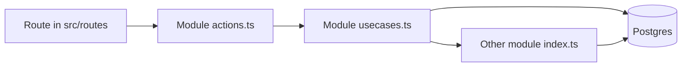

# 2-have — architecture

2-have is the operations app for one small company: customers, articles, quotes, and the order that a quote becomes. The public site name is **2-have**, the address is **2-have.eu**. Screens are in Dutch. Code, table names, and this document are in English.

It is one web app and one Postgres database. Each business area is a module. Modules talk by calling each other inside a single database transaction. There is no second service, no HTTP between modules, and no event bus.

## Brand

The mark is a navy field with three shapes: an orange circle, an amber bar, a sky bar. The file is [public/brand/logo.svg](public/brand/logo.svg). The corner outside the field is transparent, so the mark sits on any background without a white box or a JPEG fringe.

| Role | Token | Hex | Where it shows up |
| --- | --- | --- | --- |
| Field, primary buttons | `navy` | `#002083` | Logo field, buttons, links |
| Button hover | `navy-2` | `#1A3C9C` | Hover on primary buttons |
| Circle | `orange` | `#FC4F00` | Reserved accent. Do not paint large surfaces with it |
| Upper bar | `amber` | `#FF9D25` | Logo. Warning chips use a darker amber so the text stays readable |
| Lower bar | `sky` | `#479FE7` | Logo |
| Page | `paper` | `#F4F7FB` | App background |
| Ink | `ink` | `#071433` | Text |

These tokens are the press kit. They are declared once in [src/styles.css](src/styles.css). Components use the token names (`bg-navy`, `text-ink`), not raw hex.

The wordmark in the shell is **2-have**. The signed-out panel says **2-have home**. Do not put the old marketing paragraph back.

## Shape of a request



1. A route is thin. It loads data with a server function and renders a page from the module.
2. `actions.ts` checks the signed-in user and calls a use-case. It does not contain business rules.
3. The use-case runs inside `withOrg`, which opens one transaction, sets `app.user_id` for row-level security, and looks up the caller's organisation.
4. If another module must take part, the use-case calls a function exported from that module's `index.ts`, and passes the same transaction.

The shell (navigation, login, the dashboard frame) owns no business tables. Navigation is the list in [src/modules/registry.ts](src/modules/registry.ts).

## Modules

| Module | Screen | Owns | Public entry |
| --- | --- | --- | --- |
| identity | Organisatie | `orgs`, `org_members` | `withOrg`, `withUser`, `createOrg`, `setDefaultMarkup` |
| customers | Klanten | `customers` | create, list, get |
| articles | Artikelen | `articles`, `article_categories`, `article_category_links` | create, list, get, update the catalog, categories |
| quotes | Offertes | `quotes`, `quote_lines`, `quote_counters` | create, list, get, send, reject, **accept**, pricing |
| deals | none | `deals` | `openDeal`, `winDeal`, `loseDeal` |
| orders | Bestellingen | `orders`, `order_lines`, `order_counters` | `createFromQuote`, list, get |
| projects | Projecten, marked later | `projects` | types only, no use-case yet |
| planning | Planning, marked later | crew and assignments | types only, no use-case yet |

A module folder looks like this:

```
src/modules/<name>/
  index.ts        the only file other modules may import
  schema.sql      this module's tables
  boundary.ts     Zod schemas and the types the UI sees
  usecases.ts     the work
  actions.ts      server functions, thin wrappers
  components/     the screens, when the module has them
```

`index.ts` re-exports use-cases and types. It does not re-export the database queries.

## Rules that keep the modules apart

- Another module may import `@/modules/orders` (the index). It may not import `@/modules/orders/usecases` or `@/modules/orders/boundary`.
- A relative import may reach a sibling module (`../orders`). It may not reach a file inside it (`../orders/usecases`).
- Orders does not write quote tables. Quotes does not insert order lines. The hand-off is `orders.createFromQuote(tx, input)`, called by `quotes.acceptQuote`.
- The same rule will apply to projects and planning: they read an order or a customer through that module's index, on the same transaction.

`scripts/module-boundary.test.mjs` fails the build of confidence if a deep import sneaks in. Run it after a cross-module change.

## Accepting a quote

Accepting is one transaction. The screen calls `quotes.acceptQuote`. That function:

1. Locks the quote and allows only `draft` or `sent`.
2. Allocates `OFF-0001` (per organisation) if the quote has no number yet.
3. Calls `deals.winDeal` — the deal becomes `won`.
4. Calls `orders.createFromQuote` — a new order in status `confirmed`, number `ORD-0001`, lines copied.
5. Sets the quote to `accepted`.
6. Calls `projects.createFromAcceptedQuote` — one project, named from the quote number and the customer. Lines that point at an article become demand. A free-text line does not. Stock tables are not written.

Copied onto each order line: description, quantity, unit, and `unit_price_cents`. The order line does not point at a live article price. Changing an article price the next day does not change this order or this quote.

The SQL function `accept_quote` is the original order path. It does not create a project. The screen does not call it. Do not extend that function into project tables.

Statuses:

| Thing | Values |
| --- | --- |
| Quote | draft, sent, accepted, rejected |
| Deal | open, won, lost |
| Order | confirmed, in_progress, done, cancelled |
| Project | planned, in_progress, done, cancelled |

The order screen is read-only. Creating an order by hand is not a feature. An order exists because a quote was accepted.

Money is integer cents. Quantity is numeric. Line totals round `qty * unit_price_cents`. Amounts on screen are euros, formatted in the app, never stored as floats.

## Who can see a row

Signing up creates a user. The first screen after that asks for an organisation; that user becomes the owner. A user belongs to exactly one organisation (`org_members` has one row per user).

Every business table has `org_id`. Row-level security is on, and forced. Each transaction sets `app.user_id`. Policies only return rows whose organisation the current user belongs to. A preview database connects as a superuser, which would skip those policies, so the transaction switches to the role `app_user` when that role exists.

Auth is email and password. The migration that creates the auth tables is separate from the business migration.

## Database files

- `src/modules/<name>/schema.sql` is the readable source for that module's tables.
- `src/modules/_sql/` holds the shared pieces: RLS policies, grants, and the SQL function `accept_quote`.
- `migrations/0002_business.sql` is the original business schema. It has already been applied. Do not edit it.
- Later changes are new files: `0003` cost, minimum, and categories; `0004` markup and the organisation update policy; `0005` crew contact fields; `0006` project dates and demand; `0007` the stock balance and movements; `0008` suppliers and purchase orders; `0009` one assignment per person per project per day.

When you add a column or a table, change the module's `schema.sql` so the module still tells the truth, and add a **new** migration for databases that already ran `0002`. Do not edit `0001` or `0002` in place once they have been applied. New policies go in the new migration too, or the table will be invisible under RLS.

## Adding a module

1. Create `src/modules/<name>/` with `schema.sql`, `boundary.ts`, `usecases.ts`, `actions.ts`, `index.ts`, and `components/` if it has a screen.
2. Put `org_id` on every business table. Money in cents. Validate inputs with Zod in `boundary.ts` and parse them again at the start of the use-case.
3. Export only what callers need from `index.ts`.
4. Add a route under `src/routes/_app/` that calls the server function and renders the module page. Do not put SQL in the route.
5. Add one line to `moduleNav` in `src/modules/registry.ts` if it belongs in the menu.
6. Call other modules only through their `index.ts`, and only with the transaction you were given.
7. Run the module-boundary test.

Projects have a screen. Planning's screen is still marked later. Its assignment table is still a date range and is not used.

## Roadmap

Decisions for the work after the first slice:

- **Bestellingen** stays the read-only customer order. **Inkoop** is a new module for goods bought from a supplier.
- **Margin** is a percentage on top of cost. Sell = cost × (1 + markup), rounded to the cent. Stored as basis points.
- **Accepting an offerte** creates one project, and a project can also be created empty.
- **Stock** falls only when goods are issued to a project. Accept raises what is needed. It does not touch the quantity on the shelf.
- Deals stay parked: no screen, no pipeline. Accept still marks the deal won.
- Alerts are lists on screen, looking 7 days ahead. No email.
- One step at a time. The next step does not start until the current one has been checked. A conflict stops the work and is asked, not guessed.

| Step | What changes | Status |
| --- | --- | --- |
| 1 | Article cost, minimum quantity, and categories. The offerte is unchanged. | done |
| 2 | Organisation default markup, cost and markup on the quote line, margin in euros. Prove an article cost change does not rewrite a line. | done |
| 3 | Crew screen on the existing people table: contact data, employee or freelancer, active. | done |
| 4 | Empty projects, execution dates, material lines added by hand. | done |
| 5 | Accept also creates the project and the demand, in the same transaction. Prove stock does not move. | done |
| 6 | Stock movements, issuing to a project, the article stock board. | done |
| 7 | Inkoop: order, partial receipt, underway, to-buy, the 7-day list. | done |
| 8 | Planning per day: asked, confirmed, declined, short, over, conflicts. | done |
| 9 | Dashboard strips for late materials and understaffed days. | done |

Step 1 is shipped. An article now stores cost, sell price, minimum quantity, and any number of categories. Deleting a category unlinks it and leaves the article. `min_qty` is only stored: there is no stock balance and nothing is on the way. A quote line still copies the sell price only, and changing the article does not rewrite that line.

Step 2 is shipped. The organisation has a default markup in basis points (`3500` = 35%). A new quote copies it. A line stores `cost_cents`, an optional own `markup_bps` (empty means the quote's percentage), and `unit_price_cents`. Sell = cost × (1 + markup), rounded to the cent, except when the cost is zero: then the typed sell price is kept. Typing a sell price stores that exact amount and the resulting percentage. After accept or reject the numbers are frozen. Margin on the list and the quote is (sell − cost) × quantity, in euros. Changing an article afterwards does not change the line. The default is edited on the overview, under Organisatie. The first-run screen at `/organisatie` stays the create gate.

Step 3 is shipped. Crew is the existing `crew_members` table: phone, email, employee or freelancer, company, notes, and active. Deactivate, do not delete. Planning assigns these people; it does not own them.

Step 4 is shipped. A project can be created empty, with a customer or without. It has execution dates (one row per day) and a required headcount. New days copy the project's number; the number on a day can differ. Material lines added by hand are demand only. Nothing is taken off the shelf.

Step 5 is shipped. Accept calls `createFromAcceptedQuote` in the same transaction as the order. One quote, one project. Only lines with an article become demand (`source` `quote_line`). A line without an article is skipped. The function does not write `stock_balances` or `stock_movements`.

Step 6 is shipped. `stock_balances.on_hand` is the shelf. `stock_movements` records why it changed: `receipt`, `issue`, or `adjust`, with a signed quantity. Issuing to a project subtracts from the shelf and refuses to go below zero. The demand's issued quantity does not rise above what that line needs; extra issue still leaves the shelf. A count sets the shelf to the counted quantity and writes an `adjust` only when the count differs. The article board shows on hand, needed (open projects: not done, not cancelled), and to buy. Goods on the way join that sum in step 7.

Step 7 is shipped. Inkoop is its own module. A supplier is a name and contact data, deactivated rather than deleted. A purchase order is `INK-0001`, allocated when it is placed, not while it is a draft. Statuses: draft, ordered, partial, received, cancelled. A draft is not underway. Placing needs a date, an active supplier, and at least one line. A line stores the article's name and unit at that moment, and its own cost in cents. Changing the article cost afterwards does not change the line, and receiving does not change the article cost or any quote. A receipt can be partial, cannot pass the ordered quantity, and calls `articles.receiveStock` in the same transaction. Cancelling a partial order leaves what already arrived on the shelf and drops the rest from underway. To buy = max(0, needed + minimum − on hand − underway). Underway is the open quantity on orders that are ordered or partial. The inkoop screen lists arrivals with a date on or before today + 7 days, including overdue ones.

Step 8 is shipped. The old assignment was a date range and was unused. `migrations/0009_planning.sql` replaces it with one row per person, per project, per day. The date must be a project day; deleting the day deletes the row. Status is asked, confirmed, or declined. Only confirmed fills the day's required count. The same person may stand on two projects the same day. That conflict is shown, and a declined row is not a conflict. A new row starts as asked, and only an active person can be added.

Step 9 is shipped. The overview has two lists, looking 7 days ahead. No email. A day is understaffed when confirmed people are fewer than the number that day asks for. A material is late when a project in that window still has to issue it, and the shelf plus purchases expected on or before that day (not overdue, not after the job) cannot cover it. An earlier job takes the shelf first. Two days on the same project do not double the demand.

Not in these steps: email alerts, a deal pipeline, category trees, crew pay, editing an accepted quote, or attaching a second offerte to a project.

## What this app is not

- Not a workflow engine. Status changes are ordinary functions with a `where` clause.
- Not a plugin system. A module is a folder.
- Not a graph of microservices. One deployable.
- Orders are not edited. Quotes are not rewritten after they are accepted.
- A second offerte is not attached to a project that already came from one.
