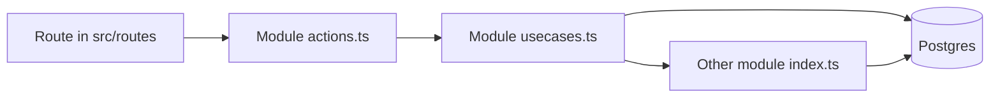

# 2-have — architecture

2-have is the operations app for one small company: customers, articles, quotes, and the order that a quote becomes. The public site name is **2-have**, the address is **2-have.eu**. Screens are in Dutch. Code, table names, and this document are in English.

It is one web app and one Postgres database. Each business area is a module. Modules talk by calling each other inside a single database transaction. There is no second service, no HTTP between modules, and no event bus.

## Brand

The mark is a navy field with three shapes: an orange circle, an amber bar, a sky bar. The file is [public/brand/logo.svg](public/brand/logo.svg). The corner outside the field is transparent, so the mark sits on any background without a white box or a JPEG fringe.

| Role | Token | Hex | Where it shows up |
| --- | --- | --- | --- |
| Field, primary buttons | `navy` | `#002083` | Logo field, buttons, links |
| Button hover | `navy-2` | `#1A3C9C` | Hover on primary buttons |
| Circle | `orange` | `#FC4F00` | Reserved accent. Do not paint large surfaces with it |
| Upper bar | `amber` | `#FF9D25` | Logo. Warning chips use a darker amber so the text stays readable |
| Lower bar | `sky` | `#479FE7` | Logo |
| Page | `paper` | `#F4F7FB` | App background |
| Ink | `ink` | `#071433` | Text |

These tokens are the press kit. They are declared once in [src/styles.css](src/styles.css). Components use the token names (`bg-navy`, `text-ink`), not raw hex.

The wordmark in the shell is **2-have**. The signed-out panel says **2-have home**. Do not put the old marketing paragraph back.

## Shape of a request



1. A route is thin. It loads data with a server function and renders a page from the module.
2. `actions.ts` checks the signed-in user and calls a use-case. It does not contain business rules.
3. The use-case runs inside `withOrg`, which opens one transaction, sets `app.user_id` for row-level security, and looks up the caller's organisation.
4. If another module must take part, the use-case calls a function exported from that module's `index.ts`, and passes the same transaction.

The shell (navigation, login, the dashboard frame) owns no business tables. Navigation is the list in [src/modules/registry.ts](src/modules/registry.ts).

## Modules

| Module | Screen | Owns | Public entry |
| --- | --- | --- | --- |
| identity | Organisatie | `orgs`, `org_members` | `withOrg`, `withUser`, `createOrg` |
| customers | Klanten | `customers` | create, list, get |
| articles | Artikelen | `articles` | create, list, get, update price |
| quotes | Offertes | `quotes`, `quote_lines`, `quote_counters` | create, list, get, send, reject, **accept** |
| deals | none | `deals` | `openDeal`, `winDeal`, `loseDeal` |
| orders | Bestellingen | `orders`, `order_lines`, `order_counters` | `createFromQuote`, list, get |
| projects | Projecten, marked later | `projects` | types only, no use-case yet |
| planning | Planning, marked later | crew and assignments | types only, no use-case yet |

A module folder looks like this:

```
src/modules/<name>/
  index.ts        the only file other modules may import
  schema.sql      this module's tables
  boundary.ts     Zod schemas and the types the UI sees
  usecases.ts     the work
  actions.ts      server functions, thin wrappers
  components/     the screens, when the module has them
```

`index.ts` re-exports use-cases and types. It does not re-export the database queries.

## Rules that keep the modules apart

- Another module may import `@/modules/orders` (the index). It may not import `@/modules/orders/usecases` or `@/modules/orders/boundary`.
- A relative import may reach a sibling module (`../orders`). It may not reach a file inside it (`../orders/usecases`).
- Orders does not write quote tables. Quotes does not insert order lines. The hand-off is `orders.createFromQuote(tx, input)`, called by `quotes.acceptQuote`.
- The same rule will apply to projects and planning: they read an order or a customer through that module's index, on the same transaction.

`scripts/module-boundary.test.mjs` fails the build of confidence if a deep import sneaks in. Run it after a cross-module change.

## Accepting a quote

Accepting is one transaction. The screen calls `quotes.acceptQuote`. That function:

1. Locks the quote and allows only `draft` or `sent`.
2. Allocates `OFF-0001` (per organisation) if the quote has no number yet.
3. Calls `deals.winDeal` — the deal becomes `won`.
4. Calls `orders.createFromQuote` — a new order in status `confirmed`, number `ORD-0001`, lines copied.
5. Sets the quote to `accepted`.

Copied onto each order line: description, quantity, unit, and `unit_price_cents`. The order line does not point at a live article price. Changing an article price the next day does not change this order or this quote.

Statuses:

| Thing | Values |
| --- | --- |
| Quote | draft, sent, accepted, rejected |
| Deal | open, won, lost |
| Order | confirmed, in_progress, done, cancelled |

The order screen is read-only. Creating an order by hand is not a feature. An order exists because a quote was accepted.

Money is integer cents. Quantity is numeric. Line totals round `qty * unit_price_cents`. Amounts on screen are euros, formatted in the app, never stored as floats.

## Who can see a row

Signing up creates a user. The first screen after that asks for an organisation; that user becomes the owner. A user belongs to exactly one organisation (`org_members` has one row per user).

Every business table has `org_id`. Row-level security is on, and forced. Each transaction sets `app.user_id`. Policies only return rows whose organisation the current user belongs to. A preview database connects as a superuser, which would skip those policies, so the transaction switches to the role `app_user` when that role exists.

Auth is email and password. The migration that creates the auth tables is separate from the business migration.

## Database files

- `src/modules/<name>/schema.sql` is the readable source for that module's tables.
- `src/modules/_sql/` holds the shared pieces: RLS policies, grants, and the SQL function `accept_quote`.
- `migrations/0002_business.sql` is those files concatenated, and it is what actually runs.

When you add a column or a table, change the module's `schema.sql` so the module still tells the truth, and add a **new** migration for databases that already ran `0002`. Do not edit `0001` or `0002` in place once they have been applied. New policies go in the new migration too, or the table will be invisible under RLS.

## Adding a module

1. Create `src/modules/<name>/` with `schema.sql`, `boundary.ts`, `usecases.ts`, `actions.ts`, `index.ts`, and `components/` if it has a screen.
2. Put `org_id` on every business table. Money in cents. Validate inputs with Zod in `boundary.ts` and parse them again at the start of the use-case.
3. Export only what callers need from `index.ts`.
4. Add a route under `src/routes/_app/` that calls the server function and renders the module page. Do not put SQL in the route.
5. Add one line to `moduleNav` in `src/modules/registry.ts` if it belongs in the menu.
6. Call other modules only through their `index.ts`, and only with the transaction you were given.
7. Run the module-boundary test.

Projects and planning already have tables and a "Later" entry in the menu. The next real work there is a use-case and a screen, not a new app.

## What this app is not

- Not a workflow engine. Status changes are ordinary functions with a `where` clause.
- Not a plugin system. A module is a folder.
- Not a graph of microservices. One deployable.
- Orders are not edited. Quotes are not rewritten after they are accepted.
- Planning does not exist yet beyond the tables. Do not invent a crew calendar until that module is actually being built.
